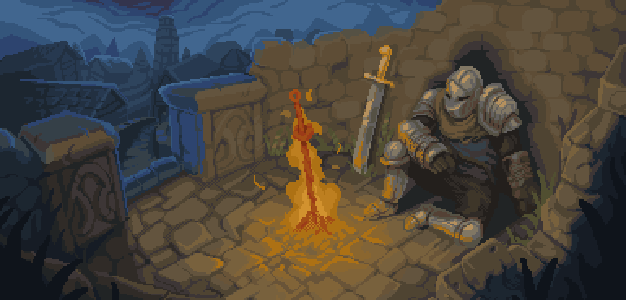

<!-- ════════════════════════════════════════════════════════════════ -->
<!--                        MAL0 · PROFILE README                       -->
<!--   Accent: #7800F0 (120,0,240) · highlights #A855F7 / #C77DFF       -->
<!--   Layout: flagship → selected projects → research → shipped →      -->
<!--   activity. Facts last checked against the repos 2026-10-26.       -->
<!-- ════════════════════════════════════════════════════════════════ -->

<!-- ───────────────────────────── BANNER ──────────────────────────── -->

  

<!-- ──────────────────────── NAME · TAGLINE ───────────────────────── -->

  

B.S. Computer Science, NJIT (expected 2029) &nbsp;·&nbsp; Wood-Ridge, NJ

  
  
  
  
  

<!-- ──────────────────────────── BIO ──────────────────────────────── -->

  I build agentic systems and the infrastructure under them: a trading platform, AI agents, a world model, and developer tools. I learn a new field by building something real in it, from scratch and with tests.

<!-- ─────────────────────────── FLAGSHIP ──────────────────────────── -->
<h3 align="center"><code>// flagship</code></h3>

  

  Hermes is a Python asyncio engine built on a typed event spine. Rust handles the order book and SEC filing parsing, and the desktop cockpit is Tauri + SolidJS. It has traded one IPO opening cross live (+9.2%). A strategy moves toward real money only by passing statistical tests (Deflated Sharpe ratio of at least 0.95, plus PSR and PBO), and the live lane stays off unless three separate switches are set.

<!-- ──────────────────────── SELECTED PROJECTS ────────────────────── -->
<h3 align="center"><code>// selected projects</code></h3>

<table align="center">
  <tr>
    <td align="right" width="160"><a href="https://github.com/mal0ware/Singularity"><b>Singularity</b></a></td>
    <td>Real-time black-hole renderer in C++20 that traces light through the Schwarzschild and Kerr metrics, one ray per pixel. Four GPU backends (Metal, Vulkan, WebGPU, CUDA) run the same physics, and CI checks it against closed-form general relativity, including Kerr ISCO radii to within 0.1%. <a href="https://mal0ware.github.io/Singularity/"><b>Run it in your browser</b></a></td>
  </tr>
  <tr>
    <td align="right"><a href="https://github.com/mal0ware/Orpheus"><b>Orpheus</b></a></td>
    <td>MCP server that lets Claude or any MCP client work inside a live REAPER session. It analyzes audio you own (tempo, key, chords, stems, lyrics) and writes tracks, MIDI and FX, asking before each change. A Lua bridge inside REAPER talks to the Python server over hardened file IPC, and it has been verified live on REAPER 7.78 and 7.83.</td>
  </tr>
  <tr>
    <td align="right"><a href="https://github.com/mal0ware/Oneiros"><b>Oneiros</b></a></td>
    <td>Learned latent world model that an agent plans with over MCP. It predicts the next latent state JEPA-style, with no pixel reconstruction, and plans in latent space with model-predictive control. The planner reaches the goal 95% of the time, against 15 to 20% for random actions. The whole thing trains in about 20 seconds on a CPU.</td>
  </tr>
  <tr>
    <td align="right"><a href="https://github.com/mal0ware/Kaizen"><b>Kaizen</b></a></td>
    <td>Personal AI agent built to run around the clock. It routes each request to a local, cheap or frontier model by difficulty, distills what it sees into pgvector memory, and applies changes to itself only after I approve them. Tested against Postgres and pgvector; deployment is next.</td>
  </tr>
  <tr>
    <td align="right"><a href="https://github.com/mal0ware/anansi"><b>anansi</b></a></td>
    <td>Claude Code plugin and standalone CLI for YouTube. Share a link and Claude gets a timestamped transcript, search results, or an mp4/m4a download. Standard-library Python with no API keys; it fetches yt-dlp and keeps it updated on its own.</td>
  </tr>
  <tr>
    <td align="right"><a href="https://github.com/mal0ware/ytmerge"><b>ytmerge</b></a></td>
    <td>Paste any text containing YouTube links and get every transcript merged onto your clipboard, or the video and audio files. A concurrent C++20 CLI (parallel workers, proxy rotation, a 7-day cache) plus a local web UI that can pull in your open YouTube tabs through a companion browser extension.</td>
  </tr>
</table>

<!-- ─────────────────────────── RESEARCH ──────────────────────────── -->
<h3 align="center"><code>// research</code></h3>

<table align="center">
  <tr>
    <td align="right" width="160"><a href="https://doi.org/10.5281/zenodo.19688805"><b>Beating the Market</b></a></td>
    <td>Sole-author working paper on how likely an actively managed fund is to beat the S&amp;P 500, using 97 years of total returns (1928 to 2024). Even a top-quartile track record implies only a 26% chance of real skill, against a 10% base rate. Every number in the paper reproduces from a seed-pinned function call, and CI re-checks the headline results on every push. <a href="https://doi.org/10.5281/zenodo.19688805">DOI</a> · <a href="https://papers.ssrn.com/sol3/papers.cfm?abstract_id=6625558">SSRN</a> · <a href="https://github.com/mal0ware/sp500-active-management-analysis">Repo</a></td>
  </tr>
  <tr>
    <td align="right"><b>SocialX Lab, NJIT</b></td>
    <td>Undergraduate researcher, spring 2026, on a study of digital patronage on streaming platforms. I ran participant interviews, coded the qualitative data, and co-wrote sections of the paper, which was submitted to CHI PLAY.</td>
  </tr>
  <tr>
    <td align="right"><a href="https://github.com/mal0ware/Pharos"><b>Pharos</b></a></td>
    <td>Survey of current AI research: world models and JEPA, self-play, continual learning, and formal verification. Each citation is tagged as shipped, announced or theory, and a zero-dependency simulation reproduces the central result of <i>Scaling Self-Play with Self-Guidance</i>.</td>
  </tr>
</table>

<!-- ─────────────────────────── SHIPPED ───────────────────────────── -->
<h3 align="center"><code>// also shipped</code></h3>

  <b>Cerebras-Protocol</b> (private): automated IPO opening-cross execution, built in 7 days, that filled at the Nasdaq cross in live trading 
  <a href="https://github.com/mal0ware/Stock-Analyzer"><b>Stock-Analyzer</b></a>: desktop stock analysis app with gradient boosting written from scratch in NumPy, within 1% of scikit-learn's accuracy, released for macOS, Windows and Linux 
  <a href="https://github.com/mal0ware/Threatscope"><b>Threatscope</b></a>: self-hosted mini-SIEM with streaming log ingestion, rule and ML detectors, and a React dashboard &nbsp;·&nbsp;
  <a href="https://github.com/mal0ware/Vixen"><b>Vixen</b></a>: Discord bot with an economy on an append-only ledger, tested against real Postgres and Redis &nbsp;·&nbsp;
  <a href="https://github.com/mal0ware/Linger"><b>Linger</b></a>: real-time chat platform on FastAPI, Postgres and Redis

<!-- ─────────────────────────── ACTIVITY ──────────────────────────── -->
<h3 align="center"><code>// activity</code></h3>

  
  

<picture>
  <source media="(prefers-color-scheme: dark)" srcset="https://raw.githubusercontent.com/mal0ware/mal0ware/output/github-snake.svg" />
  
</picture>

<code>for the love of the game.</code>

